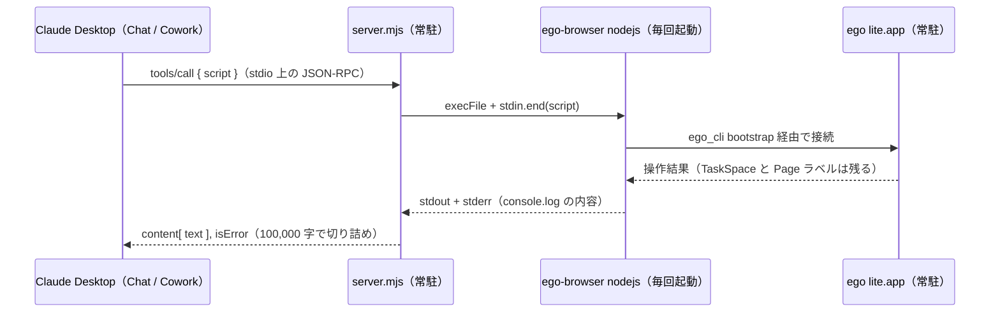

# ego lite 制御層の解説

2026-10-15 時点。ego-browser 2.0.0（2026-09-09）、ego lite 0.5.1.13、server.mjs 0.1.0 を対象とする。
SKILL.md を結果に添付する仕組み（[design.md](design.md) の「運用手順は作業の開始時に結果へ添付する」）は、この文書を書いた後に導入した。ツール説明文に関する記述は、導入前のものである。

ego lite を外から動かす仕組みは三層に分かれる。
公式スキル `ego-browser` が操作の約束事を定め、`ego-browser nodejs` CLI が実行を担い、自作の MCP サーバがその CLI を Claude Desktop の Chat / Cowork から呼べるようにしている。
本書では、スキルの中身、MCP サーバへの写し方、実機で取った比較検証を順に説明する。
ツール改善の材料にするため、検証で見つかった不具合と改善候補も最後にまとめた。

## 目次

1. [用語](#用語)
2. [背景：なぜ MCP サーバが要るのか](#背景なぜ-mcp-サーバが要るのか)
3. [（1）ego-browser スキルの解説](#1ego-browser-スキルの解説)
4. [（2）MCP サーバへの実装手法](#2mcp-サーバへの実装手法)
5. [（3）比較検証](#3比較検証)
6. [改善候補](#改善候補)
7. [補足・限界](#補足限界)

## 要点

- スキルの本体は、ego lite を Node.js スクリプトで動かすための約束事である。1 回の呼び出しごとに Node プロセスが新しく立ち上がる。呼び出しをまたいで残るのはブラウザ側の TaskSpace と Page だけで、スクリプト内の変数は残らない。
- MCP サーバは `ego_run_script` というツール 1 本だけを持ち、受け取った JavaScript を CLI の標準入力へ流す。API の説明は書き写さず、実行時に `help()` を呼ばせて取得させる。
- 実測では、5 つの操作を 1 回のスクリプトにまとめると中央値 2.34 秒、5 回に分けると 4.90 秒だった。これはサーバ側の時間だけで、モデルの往復時間は含まない。
- 検証中、Claude Desktop の設定が移動前のパスを指したままで、2026-10-14 15:41 (UTC) から 2026-10-15 04:51 (UTC) まで、Desktop 側でサーバが起動していなかったことが分かった。現在は修正済み。

## 用語

- **ego lite**：人間と AI エージェントが同じ画面を共有して使う Chromium ブラウザ。利用者のログイン済みセッションをエージェントも使える。
- **スキル**：エージェントに手順と約束事を与える文書の束。自身は実行手段を持たず、シェルなどエージェント側の実行手段に頼る。
- **MCP**：Model Context Protocol。AI クライアントが外部のツールを呼ぶための通信規約。ここでは標準入出力上の JSON-RPC を使う。
- **CDP**：Chrome DevTools Protocol。Chromium を外部から操作するための低レベルな命令体系。
- **TaskSpace**：エージェントの作業単位となるタブのまとまり。ego lite 本体に残り、数値の id か名前で再開できる。
- **Page ラベル**：TaskSpace 内の管理下のタブに付く永続的な名前。`p1`、`p2` など。
- **ラウンド**：本書の用語。`ego-browser nodejs` を 1 回起動し、スクリプトを実行し終えるまでの単位。
- **snapshot**：ページのアクセシビリティツリーをテキストにしたもの。操作できる要素に ref が付く。
- **ref**：snapshot 内の要素番号。`@21` の形で操作対象に指定する。ページが変わると無効になる。
- **受領情報**：receipt。操作の直後に観測したポップアップやダイアログの記録。結果の正しさは保証しない。
- **handOff**：操作権をユーザーに渡す API。ユーザー自身が操作すべき場面で使う。

## 背景：なぜ MCP サーバが要るのか

ego lite 公式が配っている `ego-browser` はスキルとして提供されている。
中身は「シェルで `ego-browser nodejs` を起動し、ヒアドキュメントで JavaScript を渡す」という手順書である。
そのため、Claude Code や Codex のようにシェルを実行できるエージェントでなければ動かせない。
Claude Desktop の Chat / Cowork にはシェルを実行する手段がないので、スキルを読み込ませても実際に動かす部分が欠ける。

その欠けた部分を埋めるのが `server.mjs` である。
ブラウザの制御そのものは CLI 側に揃っているので、サーバは CDP を自分で扱う必要がない。
「子プロセスを起動し、標準入力にスクリプトを流し、出力を返す」という 85 行で足りている。

## （1）ego-browser スキルの解説

### ディレクトリ構成

`~/.agents/skills/ego-browser`（リポジトリでは `ego-browser-skill` というシンボリックリンク）の中身は次のとおりである。

| パス | 役割 |
|---|---|
| `SKILL.md` | 運用の約束事。19,556 バイト |
| `references/api.md` | API シグネチャ一覧。51,902 バイト。`public-api-schema.ts` から生成 |
| `references/install.md` | 導入と PATH の確認手順 |
| `references/clearing-state.md` | Cookie やストレージを消すときの注意 |
| `scripts/install.sh` | macOS 向けの DMG 導入スクリプト |
| `learnings/` | サイト別のノートと抽出スクリプト（github / google / x-com）。後述のとおり現行 API とずれている |

### 実行モデル：ラウンドと永続するもの

スキルの説明は、ほぼ全体が次の前提に立っている。
エージェントが `ego-browser nodejs` を 1 回呼ぶ単位を、本書では**ラウンド**と呼ぶ。
ラウンドごとに新しい Node.js プロセスが起動し、終わると消える。
一方、ブラウザ側の TaskSpace（タブのまとまり）と、Page に付いたラベル（`p1`、`p2` など）は ego lite 本体に残る。

| 対象 | ラウンドをまたいで残るか |
|---|---|
| JavaScript の変数 | 残らない |
| TaskSpace | 残る。`spaceId`（数値）か名前で再開する |
| Page ラベル | 残る。`task.page("p1")` で再取得する |
| snapshot の ref | ページが変わると無効になる |
| `page.targetId` | 保存して次ラウンドで使ってはならない |

この前提から、スキルの規則が導かれる。
1 つのユーザー目標には TaskSpace を 1 つだけ使い、最初に `spaceId` を出力して次のラウンドで再開する。
詰まったときも新しいスペースを作って逃げず、同じスペースの中で立て直す。
URL を変えるときは新しい Page を開かず、`goto()` で同じ Page を使い回す。

### 観測の作法：一度にまとめて、最後に snapshot

スキルが最も紙幅を割いているのは、観測の回数を減らす書き方である。
エージェントのコストは、モデルの往復回数と、モデルに渡すページ情報の量で決まる。
そこでスキルは次の 3 点を求めている。

- 次の行動を決めるのに足りる、最も安い観測だけを取る。意味構造には snapshot、見た目の確認には screenshot を使い、両方を既定で取らない。
- 同じ Page 上で計画できる操作は 1 ラウンドにまとめ、最後の期待状態を待ってから snapshot を 1 回だけ出力する。
- その最後の snapshot が、次のラウンドの出発点になる。これを省くと、次のラウンドは観測のためだけに 1 回余計に呼び出すことになる。

snapshot はアクセシビリティツリーをテキストにしたものである。
今回 example.com で実際に取得した出力を示す（多言語の段落は省略した）。

```text
[p1 "Example Domain" | space "bench snap"(9): 1 managed, 0 untracked — p1* "Example Domain"]
root
  svg_root
  paragraph
    text "This domain is for use in documentation examples without needing permission. ..."
  paragraph
    text "该域名仅用于文档示例，无需获得许可。..."
  anchor [ref=1, loc=href:https://iana.org/help/example-domains, url=https://iana.org/help/example-domains]
    text "Learn more"
```

1 行目のヘッダに、現在の Page、スペース名と id、管理下のタブ数が入る。
操作できる要素には `ref=1` が付いており、次の操作では `@1` と書いて指定できる。
`loc=href:...` はページが変わっても同じ要素を探し直せる指定子である。
この出力は 1,160 文字ほどで、スクリーンショット画像を渡すより桁違いに軽い。

### 要素の指定と、Playwright との違い

要素の指定には snapshot の ref（`@21`）、`text=...`、`loc=role:button[name='Sign in']` のような ego 独自の locator、XPath、CSS が使える。
どの指定も**一致が 1 件でなければ失敗**する。複数の要素に当たったときに黙って先頭を選ぶことはない。

メソッド名は Playwright によく似ているが、Playwright ではない。
スキルは `locator()`、`getByRole()`、`expect()` などを推測で呼ぶことを明示的に禁じている。
用意された API で足りないときは、`page.evaluate()`（ページ内で JS を実行する）か `page.cdp()`（CDP を直接呼ぶ）を使う。
エージェントは学習データにある Playwright の書き方に引きずられやすいので、この注意書きが重要になる。

### 受領情報、ユーザーへの引き渡し、終了

`click()` などの高レベル操作は「受領情報（receipt）」を返す。
操作の直後に開いたポップアップ（`receipt.popups`）と同期ダイアログ（`receipt.dialog`）がここに入る。
ただし、受領情報は「操作を送った」ことの記録であって、アプリ側の状態が期待どおりになったことの確認ではない。

人間との共同作業にかかわる API は 3 つある。

- `task.handOff()`：操作権をユーザーに渡してラウンドを終える。ログインや権限の確認など、ユーザーが自分で操作すべき場面で使う。
- `takeOverTaskSpace(id)`：ユーザーが作業を終えたあと、同じスペースを取り戻す。
- `task.finish({ keep: [] })`：成功時に 1 回だけ呼び、スペースを閉じる。ユーザーが作ったタブは保護され、閉じられない。

エラーで止まったときやユーザーに引き渡したときは `finish()` を呼ばない、とスキルは定めている。
スペースを残しておき、後で再開できるようにするためである。
この規則が検証結果の解釈にかかわるので、（3）で改めて触れる。

### learnings ディレクトリの位置づけ

`learnings/` には、サイトごとの `manifest.json`、DOM の構造メモ、抽出スクリプトが入っている。
しかし `SKILL.md` からも `help()` の出力からも参照されていない。
さらに、スクリプトが呼んでいるのは `ctx.openOrReuseTab()`、`ctx.waitForLoad()`、`ctx.js()` で、現行 v2 の TaskSpace / Page API ではない。

```javascript
// learnings/github/tools/search-repos.js（抜粋）
export async function searchRepos(ctx, args = {}) {
  await ctx.openOrReuseTab(`https://github.com/search?q=...`, { wait: true });
  await ctx.waitForLoad();
  const repos = await ctx.js(String.raw`(() => { ... })()`);
  return repos;
}
```

実行環境で確かめると、グローバルの `openOrReuseTab` は関数として残っていたが、`ctx` は未定義で、`help()` にも載っていない。
旧 API の名残が同梱されているだけで、現行スキルの手順には組み込まれていない、と読むのが妥当である。
design.md が記録している「公式サイトの API 一覧と実物が違った」件と同じ種類のずれである。

## （2）MCP サーバへの実装手法

### 全体の流れ



`ego_run_script` 1 回あたりのデータの流れを示す。
server.mjs と ego lite は常駐し、間の CLI だけが呼び出しごとに生成・破棄される。
スクリプト内の変数は、この CLI と一緒に消える。

Claude Desktop は `claude_desktop_config.json` の `mcpServers` に書かれたコマンドを子プロセスとして起動し、標準入出力で JSON-RPC をやり取りする。
サーバは `tools/call` を受けるたびに `ego-browser nodejs` を起動し、スクリプトを標準入力に書き込んで閉じる。
CLI は内部サービス（エラー文言に出る `ego_cli bootstrap`）経由で ego lite 本体に接続し、スクリプトを実行して終了する。

### 設計判断 1：ツールは 1 本にする

`ego_navigate`、`ego_click`、`ego_snapshot` のように操作ごとにツールを分ける構成は採っていない。
理由は 2 つある。
1 つは、分けると操作のたびに CLI の起動（約 0.4 秒）とモデルの往復が発生すること。
もう 1 つは、それがスキルの「操作をまとめて最後に 1 回だけ観測する」という作法と正面から衝突することである。
ツールが 1 本なら、スキル向けに書かれた手順がそのまま MCP 経由でも通用する。

```javascript
server.registerTool(
  "ego_run_script",
  {
    title: "Run a script in the ego lite browser",
    description: `...`, // 1,410 文字。内容は次節
    inputSchema: { script: z.string().describe("JavaScript to execute. Use console.log() to return results.") },
    annotations: { readOnlyHint: false, destructiveHint: true, openWorldHint: true },
  },
  ({ script }) => runScript(script),
);
```

`annotations` では `destructiveHint: true` を宣言している。
これはクライアントへのヒントで、サーバ側で何かを止めるものではない。

### 設計判断 2：ツール説明はスキルの圧縮版にし、詳細は help() に任せる

ツールを 1 本にすると、ふつうは全 API の説明をツールの説明文に詰め込むことになる。
ego-browser の実行環境には `help()` が組み込まれており、API の説明を実行時に返してくれるので、それをする必要がない。
説明文が担っているのは、スキルのうち**呼び出しの前に知っておかないと事故になる部分**だけである。

| 説明文に入れたこと | 対応するスキルの記述 |
|---|---|
| Node で動き、ページ内ではない | Run browser scripts 節。`window` などは `evaluate()` の中だけ |
| 戻り値は console.log だけ | CLI の出力仕様 |
| 変数は残らずスペースは残る | Spaces, rounds, and pages 節 |
| 最初に help() と SKILL.md を読む | References 節。読み込みは `node:fs/promises` で行う |
| 1 目標 1 スペース、finish は 1 回 | User control and completion 節 |
| 取り消せない操作は handOff | MCP 側で追加した規則 |

`SKILL.md` も複製しない。
説明文には、スクリプトの中から `fs.readFile()` でスキル本体を読み出すコードが書いてある。
`ego-browser upgrade` でスキルが更新されても、サーバ側を直す必要はない。

### 設計判断 3：出力は stderr と stdout を連結して返す

ego-browser の組み込み Node は、`console.log()` の出力を標準エラーに書く。
そのため「stderr に何か出たら失敗」という一般的な判定は使えない。
サーバは終了コードだけで成否を決め、成功時には両方を連結して返す。

```javascript
// ego-browser の埋め込み Node は console.log を stderr に書く。
// 成功時の出力もここに来るため、stderr を異常扱いせず連結する。
const out = stdout + stderr;
```

### 設計判断 4：失敗時は原因別のヒントを添える

エラー時は stderr をそのまま返し、末尾にモデル向けの一文を付ける。
エラーの中身を読んだモデルが、次に何をすべきか判断できるようにするためである。

| 条件 | 添える一文の趣旨 |
|---|---|
| `ENOENT` | `EGO_BROWSER_BIN` に絶対パスを設定する |
| `killed` | 180 秒で打ち切った。作業を複数回に分ける |
| それ以外 | ego lite が起動していない可能性。ユーザーに起動を頼む |

出力が 100,000 文字を超えたときは切り詰め、`snapshot({ scope: "subtree", root: "@N" })` で範囲を絞るよう案内する。
このほか、起動に失敗したときに stdin への書き込みで出る `EPIPE` を握りつぶし、サーバ自体が落ちないようにしている。

### 設計判断 5：危険操作はサーバで止めず、承認画面に任せる

ログイン済みのセッションで動くので、送信・購入・削除も実行できてしまう。
語句を検査して拒否する方式は、`@21` のような ref 指定には効かず、送信ボタンを探すだけの安全なスクリプトまで拒否してしまうので採らなかった。
代わりに、Claude Desktop がツールを実行する前に出す承認画面で、利用者がスクリプトの全文を読んでから許可する前提に立っている。
この前提は、**`ego_run_script` を「常に許可」にしない**ことでのみ成り立つ。

### 疎通テスト

`test.mjs` は Claude Desktop と同じ形で、標準入出力越しにサーバを動かす。
確認するのは `initialize`、`tools/list`、成功する `tools/call`（`help("taskSpace")`）、例外を投げる `tools/call`（`isError: true` になるか）の 4 つである。
2026-10-15 に実行し、`all checks passed` を確認した。

```bash
EGO_BROWSER_BIN="$(command -v ego-browser)" node test.mjs
```

## （3）比較検証

2026-10-15 に、起動中の ego lite 0.5.1.13 に対して計測した。
対象は、モデルに渡す文書の量、CLI 1 回の起動コスト、まとめ実行と分割実行の所要時間の 3 つである。

### 検証 A：モデルに渡る文書の量

スキル方式と MCP 方式の最大の違いは、説明文がいつ、どれだけモデルの文脈に入るかにある。

| 文書 | 大きさ | 読み込まれる時機 |
|---|---|---|
| ツール説明文 | 1,410 文字 | MCP 方式。ツール一覧として常に入る |
| `help()` 全体 | 14,603 文字 | MCP 方式。モデルが最初に呼んだときだけ |
| `SKILL.md` | 19,556 バイト | スキル方式では起動時に本文を読む。MCP 方式では任意 |
| `api.md` | 51,902 バイト | どちらの方式でも必要なときだけ |

スキル方式では、ブラウザを使うと決めた時点で約 2 万バイトの約束事がまとめて文脈に入る。
MCP 方式で常に入るのは 1.4 千文字だけで、残りはツール呼び出し 1 回分の手間と引き換えに、必要になったときに取得する。
その代わり、MCP 方式でモデルが `SKILL.md` を読まないまま作業を始めると、説明文に書いていない約束事（観測の作法、ref の扱いなど）は伝わらない。
説明文を短く保つことと、約束事を確実に伝えることは両立しにくい。

### 検証 B：CLI 1 回の起動コスト

`ego-browser nodejs -e 'console.log(1)'` を 3 回実行したところ、実時間は 0.41 秒、0.46 秒、0.41 秒だった。
ブラウザを操作しなくても、1 回の呼び出しにつき約 0.4 秒かかる。
スキル方式でもシェルから同じ CLI を起動するので、この費用は両方式に共通である。
MCP サーバ自体は常駐しているので、これに上乗せされる費用は誤差の範囲にとどまる。

### 検証 C：まとめ実行と分割実行

MCP サーバに `test.mjs` と同じ形で接続し、同じ 5 つの操作を 2 通りに実行した。
操作は、スペース作成、example.com への移動、snapshot、`evaluate()` でのタイトル取得、`finish()` である。
まとめ実行は 1 回の `tools/call`、分割実行は 5 回の `tools/call` で行い、分割側は 2 回目以降に `taskSpace(id)` で同じスペースを再開した。
5 試行を行い、1 回目は起動直後の影響が出るため別に示す。

| 方式 | 1 回目 | 2〜5 回目（中央値） |
|---|---|---|
| まとめ実行（1 呼び出し） | 3,951 ms | 2,341 ms（2,038〜3,107） |
| 分割実行（5 呼び出し） | 6,122 ms | 4,904 ms（4,658〜5,074） |

差は約 2.6 秒で、増えた呼び出し 4 回で割ると 1 回あたり約 0.64 秒になる。
検証 B の起動コスト 0.4 秒に、スペースへの再接続の費用が加わった値と見てよい。
全試行で `isError` は立たず、終了後の `listTaskSpaces()` に計測用のスペースは残っていなかった。

この数字は**サーバ側の時間だけ**である。
実際の利用では、分割した呼び出しのたびにモデルの推論 1 往復と、その入出力のトークンが加わる。
モデルの往復は 1 回で数秒かかることが多いので、実利用での差はこの表よりずっと大きくなる。
この表の比率を、そのまま体感の速度差と読んではいけない。

### 検証中に起きた 3 つの事象

**失敗時のスペース残存。**
最初の計測では、example.com から `h1` がなくなっていたため `evaluate()` が例外を投げた。
まとめ実行は `finish()` に届かず、スペースが残った。
スキルの規則どおりの挙動だが、スクリプトが最初に `spaceId` を出力していないと、id での再開ができない。

**名前による再利用。**
`taskSpace(name)` は同名のスペースがあれば再利用する。
残ったスペースは次の試行に再利用され、Page がすでに目的の URL にあったため所要時間が 0.8 秒まで縮んだ。
この初回の計測値は無効とし、表には載せていない。

**一度だけの停止。**
残ったスペースを `taskSpace(5)` と `finish()` で閉じようとした呼び出しが、5 分以上返らなかった。
直後に同じ操作を単独で行うと、それぞれ 96 ms と 41 ms で完了した。
原因は特定できておらず、再現もしていない。
この停止は、MCP サーバの 180 秒タイムアウトがあれば打ち切られる。
シェルから直接実行するスキル方式には、この上限がない。

## 改善候補

検証で分かったことを、効果が大きく手間が小さいものから順に並べる。

### 1. Claude Desktop の設定パスを直す（修正済み）

`claude_desktop_config.json` と README の設定例は、移動前の `~/dev/ego-lite/server.mjs` を指していた。
リポジトリの実際の場所は `~/dev/agents/ego-lite` である。
`~/Library/Logs/Claude/mcp-server-ego-lite.log` によると、最後に起動に成功したのは 2026-10-14 14:01 (UTC) で、15:41 以降は `Cannot find module` で毎回失敗していた。
2026-10-15 に次の修正を行い、04:51 (UTC) に起動成功のログを確認した。
あわせて、MCP 経由で TaskSpace の作成、example.com への移動、`finish()` までが通ることも確かめた。

```diff
 "ego-lite": {
   "command": "node",
-  "args": ["/Users/<user>/dev/ego-lite/server.mjs"],
+  "args": ["/Users/<user>/dev/agents/ego-lite/server.mjs"],
   "env": { "EGO_BROWSER_BIN": "/Users/<user>/.local/bin/ego-browser" }
 }
```

### 2. 説明文で「spaceId を最初に出力する」を強める

現在の説明文の最小例は、`spaceId` を snapshot と同じ `console.log` で最後に出力している。
途中で例外が出ると id が返らず、モデルは名前での再開に頼るしかなくなる。
スペースを作った直後の行で出力する例に変えるだけで、検証で起きた状況を避けられる。

```diff
   const task = await taskSpace("what the user asked for");
+  console.log("spaceId", task.spaceId);
   const page = task.page("p1");
   await page.goto("https://example.com");
-  console.log(task.spaceId, await page.snapshot());
+  console.log(await page.snapshot());
```

ただし、ego-browser の組み込み Node が、例外で終了したときにそれまでの `console.log` を出力し切るかどうかは確かめていない。
変更後に、例外を投げるスクリプトで確認する必要がある。

### 3. 読み取り専用ツールを分けて「常に許可」にする

design.md で次の一手として残している案である。
URL を受け取り、`goto()` と `snapshot()` を行ってスペースを閉じるだけの固定処理を別のツールとして立てる。
任意のスクリプトを受け付けないので、そちらだけを「常に許可」にしても歯止めは失われない。
日常の調べ物で承認画面を毎回押す負担が減る。

### 4. 細かい不整合

- 出力が 32MB の `maxBuffer` を超えたときも「ego lite が起動していない可能性」と表示される。design.md にも記載済みの既知の問題である。
- `learnings/` は旧 API で書かれている。MCP の説明文から案内していないので害はないが、モデルがディレクトリを探索して読んだ場合に誤った API を覚える可能性がある。

## 補足・限界

- 検証 C はサーバ側の時間だけを測っている。Claude Desktop 上でモデルを介した端から端までの時間は計測していない。
- Claude in Chrome や Claude Desktop の組み込みブラウザとは比較していない。定性的に言えば、ego lite の特徴は利用者本人のログイン済みセッションと、TaskSpace による人間との作業の受け渡しにある。
- 計測対象は example.com 1 ページで、試行も 5 回だけである。重いページや、ログインが必要なページでの傾向は分からない。
- design.md の未検証事項（ego lite を終了させた状態でのエラー文言、承認画面でのスクリプト全文の見え方）は、今回も確かめていない。
- 計測に使ったスクリプトは作業用ディレクトリに置いた一時ファイルで、リポジトリには含めていない。
